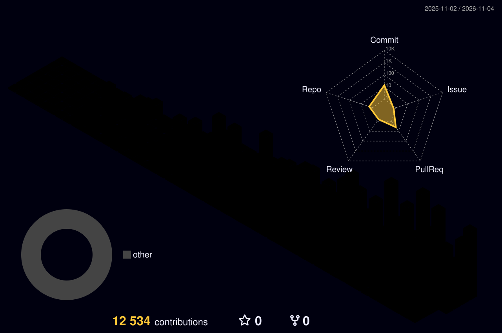

 

 

  

### Two founders. One shared workspace.

**We design, engineer, and ship digital products — from the first idea to production.**

---

<table>
  <tr>
    <td width="50%" valign="top">
      <b>01 / FOUNDER</b>
      <h2>Akshat Kumar</h2>
      Product direction 
      Engineering & development
    </td>
    <td width="50%" valign="top">
      <b>02 / CO-FOUNDER</b>
      <h2>Sarthak Jha</h2>
      Product collaboration 
      Engineering
    </td>
  </tr>
</table>

> **One account, two contributors.** Projects and account-level statistics represent this shared workspace, not either founder's individual activity.

## What we build

<table>
  <tr>
    <td width="50%" valign="top">
      <h3>⌘ Product engineering</h3>
      Turning concepts into useful, maintainable software.
    </td>
    <td width="50%" valign="top">
      <h3>◈ Web applications</h3>
      Full-stack platforms, dashboards, and product interfaces.
    </td>
  </tr>
  <tr>
    <td width="50%" valign="top">
      <h3>⚙ Backend systems</h3>
      APIs, authentication, data architecture, and integrations.
    </td>
    <td width="50%" valign="top">
      <h3>↗ Shipping & reliability</h3>
      Deployment, debugging, performance, and production operations.
    </td>
  </tr>
</table>

## Selected work

<table>
  <tr>
    <td width="50%" valign="top">
      <b>PRODUCT / 001</b>
      <h2><a href="https://tgdrive-2f2ed27ee0c2.herokuapp.com">TG-Drive ↗</a></h2>
      A Telegram-powered personal cloud drive, with a dedicated web interface for managing files.
        
      
    </td>
    <td width="50%" valign="top">
      <b>STUDIO / 002</b>
      <h2><a href="https://xyrenlabs.in">XyrenLabs ↗</a></h2>
      Our development studio, focused on shaping ideas into polished digital products and software experiences.
        
      
    </td>
  </tr>
</table>

## Tools in our workflow

---

## GitHub / Account analytics

These visuals are generated by our own GitHub Actions workflow and stored in this repository, rather than relying on third-party live card endpoints.

Metrics are refreshed daily. Private repository names and source details are intentionally not included in the public visuals.

## Contribution snake

<picture>
  <source media="(prefers-color-scheme: dark)" srcset="./profile-assets/github-snake-dark.svg" />
  <source media="(prefers-color-scheme: light)" srcset="./profile-assets/github-snake.svg" />
  
</picture>

## 3D contribution landscape

---

### BUILD WITH INTENT. SHIP WITH CARE.

<a href="https://github.com/ev-pro047">GitHub</a>
&nbsp;·&nbsp;
<a href="https://xyrenlabs.in">XyrenLabs</a>
&nbsp;·&nbsp;
<a href="https://tgdrive-2f2ed27ee0c2.herokuapp.com">TG-Drive</a>

EV / PRO — Shared engineering workspace · India

